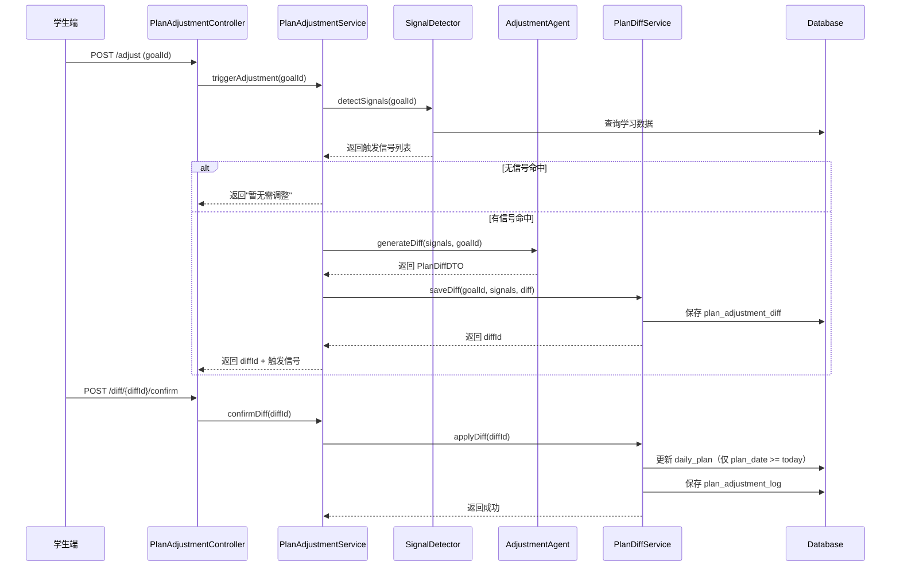

# Design：计划调整系统（v2 修复版）

> **Change 名称**：`2026-11-03_plan_adjustment`  
> **版本**：v3（修复 BLOCK-B + IMP-28）

---

## 0. 审查修复追溯

| 编号 | 问题 | 修复方案 |
|------|------|----------|
| BLOCK-12 | uk_goal_adjust_time (goal_id, action_at) 并发冲突 | 唯一索引改为 `(goal_id, diff_id, tenant_id)`——一个 diff 只能有一个终态 |
| BLOCK-13 | cleanExpiredDiffs 长事务 + 无定时任务 | 改为批量 UPDATE + 批量 INSERT；新增 `@Scheduled(cron="0 0 2 * * ?")` 定时任务 |
| BLOCK-14 | SIG-4 capDay/eff 硬编码 + kUncovered 语义错误 | capDay/eff 改为 application.yml 配置项；kUncovered 改为 masteryScore IS NULL（从未学习） |
| IMP-20 | Agent 成功但 saveDiff 失败时 diff 丢失 | design 中明确说明：用户重新触发即可，Agent 调用幂等 |
| IMP-21 | applyDiff 重置已完成的历史计划为 pending | 只更新 `plan_date >= today` 的未来计划 |
| IMP-22 | AdjustmentAgentOutput 与 PlanDiffDTO 字段重复 | 合并为单一 DTO：`PlanDiffDTO` |
| IMP-23 | /adjust 用 @RequestParam | 改为 POST + @RequestBody `AdjustRequestDTO` |
| IMP-24 | cleanExpiredDiffs 执行频率未明确 | `@Scheduled(cron="0 0 2 * * ?")` 每天凌晨 2 点执行 |
| 错误码 | 1130-1135 与试卷分析冲突 | 改为 **1140-1149** 编号段 |
| N1 上下文 | 管理端接口复用 StudentContext | 与 AdminGoalController 保持一致，标注 N1 |
| BLOCK-B | plan_adjustment_diff 的 uk_goal_diff (goal_id, id, tenant_id) 包含自增主键，索引无效 | 去掉 diff 表的唯一索引（id 主键已唯一）；“同一 goal 同时只允许一个 pending diff”由应用层保证（triggerAdjustment 前查重） |
| IMP-28 | SignalConfig 缺少 @Component 或 @EnableConfigurationProperties | 注明 SignalConfig 需 `@Component` + `@ConfigurationProperties` |
| NOTE-3 | SignalConfig 嵌套配置无校验，capDay=0 会误触发 SIG-4 | 添加 `@Validated` + `@DecimalMin`/`@DecimalMax` 校验，配置非法时启动失败 |

---

## 1. 架构设计

### 1.1 核心流程



---

## 2. 数据库设计

### 2.1 plan_adjustment_diff（修复 BLOCK-B：去掉无效唯一索引）

```sql
CREATE TABLE plan_adjustment_diff (
    id BIGINT PRIMARY KEY AUTO_INCREMENT,
    goal_id BIGINT NOT NULL,
    status VARCHAR(20) NOT NULL DEFAULT 'pending',  -- pending/confirmed/rejected/expired
    trigger_signals JSON NOT NULL,
    diff_content JSON NOT NULL,
    expire_at DATETIME NOT NULL,
    confirmed_at DATETIME,
    rejected_at DATETIME,
    tenant_id VARCHAR(50) NOT NULL DEFAULT 'default',
    create_time DATETIME NOT NULL DEFAULT CURRENT_TIMESTAMP,
    update_time DATETIME NOT NULL DEFAULT CURRENT_TIMESTAMP ON UPDATE CURRENT_TIMESTAMP,
    FOREIGN KEY (goal_id) REFERENCES learning_goal(id),
    -- 修复 BLOCK-B：去掉 uk_goal_diff (goal_id, id, tenant_id)
    -- 原因：id 是自增主键，包含主键的唯一索引无防重意义
    -- “同一 goal 同时只允许一个 pending diff”由应用层保证（见 triggerAdjustment）
    INDEX idx_goal_status (goal_id, status, tenant_id),
    INDEX idx_expire (expire_at, status, tenant_id)
) ENGINE=InnoDB DEFAULT CHARSET=utf8mb4;
```

### 2.2 plan_adjustment_log（保留唯一索引）

```sql
CREATE TABLE plan_adjustment_log (
    id BIGINT PRIMARY KEY AUTO_INCREMENT,
    goal_id BIGINT NOT NULL,
    diff_id BIGINT NOT NULL,
    trigger_signals JSON NOT NULL,
    diff_content JSON NOT NULL,
    action VARCHAR(20) NOT NULL,  -- confirmed/rejected/expired
    action_at DATETIME NOT NULL,
    tenant_id VARCHAR(50) NOT NULL DEFAULT 'default',
    create_time DATETIME NOT NULL DEFAULT CURRENT_TIMESTAMP,
    FOREIGN KEY (goal_id) REFERENCES learning_goal(id),
    FOREIGN KEY (diff_id) REFERENCES plan_adjustment_diff(id),
    -- 保留：一个 diff 只能有一条 log 记录，这个唯一索引有意义（diff_id 不是本表主键）
    UNIQUE KEY uk_goal_diff (goal_id, diff_id, tenant_id),
    INDEX idx_goal (goal_id, tenant_id)
) ENGINE=InnoDB DEFAULT CHARSET=utf8mb4;
```

### 2.3 DDL 版本声明

- 本 Change 使用 **V7__plan_adjustment.sql**
- V7 依赖 V6（exam_paper_analysis）已 apply
- 后续 Change 依赖：V8（learning_record_index）→ V9（admin_list_index）

---

## 3. 触发信号检测（修复 BLOCK-14）

### 3.1 SignalConfig 配置类（修复 IMP-28）

```java
// 修复 IMP-28 + NOTE-3：必须加 @Component + @Validated
// @Validated 保证配置值非法时启动失败，而非静默误触发
@Data
@Component
@Validated
@ConfigurationProperties(prefix = "plan.adjustment")
public class SignalConfig {
    @Valid
    private Sig4Config sig4;
    @Valid
    private Sig1Config sig1;
    @Valid
    private Sig2Config sig2;
    @Valid
    private Sig3Config sig3;

    @Data
    public static class Sig4Config {
        @DecimalMin(value = "0.1", message = "cap-day 最小为 0.1")
        @DecimalMax(value = "20.0", message = "cap-day 最大为 20.0")
        private double capDay = 3.0;

        @DecimalMin(value = "0.1", message = "efficiency 最小为 0.1")
        @DecimalMax(value = "1.0", message = "efficiency 最大为 1.0")
        private double efficiency = 0.8;
    }
    @Data
    public static class Sig1Config {
        @Min(value = 1)
        private int windowDays = 7;
        @DecimalMin(value = "0.01")
        @DecimalMax(value = "1.0")
        private double threshold = 0.6;
        @Min(value = 1)
        private int consecutiveCount = 3;
    }
    @Data
    public static class Sig2Config {
        @DecimalMin(value = "0.01")
        @DecimalMax(value = "1.0")
        private double masteryDrop = 0.15;
    }
    @Data
    public static class Sig3Config {
        @Min(value = 1)
        private int consecutiveDays = 2;
    }
}
```

### 3.2 SIG-4 配置化

```yaml
# application.yml
plan:
  adjustment:
    sig4:
      cap-day: 3.0       # 每天学习容量（知识点数）
      efficiency: 0.8     # 学习效率因子
    sig1:
      window-days: 7      # SIG-1 窗口天数
      threshold: 0.6      # SIG-1 正确率阈值
      consecutive-count: 3  # SIG-1 连续次数
    sig2:
      mastery-drop: 0.15  # SIG-2 掌握度下降阈值
    sig3:
      consecutive-days: 2 # SIG-3 连续未完成天数
```

### 3.2 SIG-4 语义修正

```java
// 修复 BLOCK-14：kUncovered = 从未学习过的知识点（masteryScore IS NULL 或 0）
// 而非 masteryScore < 0.8（"未掌握"≠"未覆盖"）
private List<TriggerSignalDTO> detectSIG4(Long goalId) {
    LearningGoal goal = goalMapper.selectById(goalId);
    long dRemain = ChronoUnit.DAYS.between(LocalDate.now(), goal.getEndDate());
    
    // 从配置读取 capDay 和 eff（不再硬编码）
    double capDay = sig4Config.getCapDay();
    double eff = sig4Config.getEfficiency();
    
    // 修复 BLOCK-14：kUncovered = 从未学习过（masteryScore IS NULL）
    long kUncovered = studentKnowledgeStateMapper.countUncoveredByGoalId(goalId);
    
    if (dRemain * capDay * eff < kUncovered) {
        // 触发 SIG-4
    }
}
```

---

## 4. 分层设计

### 4.1 Controller 层（修复 IMP-23）

```java
@RestController
@RequestMapping("/api/student/plan")
public class PlanAdjustmentController {

    /**
     * 修复 IMP-23：触发调整是写操作，使用 POST + @RequestBody
     */
    @PostMapping("/adjust")
    public Result<AdjustTriggerVO> triggerAdjustment(@RequestBody @Valid AdjustRequestDTO request) {
        return Result.success(planAdjustmentService.triggerAdjustment(request.getGoalId()));
    }

    @GetMapping("/diff/{diffId}")
    public Result<PlanDiffDetailVO> getDiffDetail(@PathVariable Long diffId) {
        return Result.success(planAdjustmentService.getDiffDetail(diffId));
    }

    @PostMapping("/diff/{diffId}/confirm")
    public Result<Void> confirmDiff(@PathVariable Long diffId) {
        planAdjustmentService.confirmDiff(diffId);
        return Result.success();
    }

    @PostMapping("/diff/{diffId}/reject")
    public Result<Void> rejectDiff(@PathVariable Long diffId) {
        planAdjustmentService.rejectDiff(diffId);
        return Result.success();
    }

    @GetMapping("/adjustments")
    public Result<PageResult<AdjustmentHistoryVO>> getAdjustmentHistory(
            @RequestParam(value = "page", defaultValue = "1") Integer page,
            @RequestParam(value = "size", defaultValue = "10") Integer size) {
        return Result.success(planAdjustmentService.getAdjustmentHistory(page, size));
    }
}
```

### 4.2 PlanAdjustmentServiceImpl（修复 BLOCK-B：应用层防重）

```java
@Service
public class PlanAdjustmentServiceImpl implements PlanAdjustmentService {

    /**
     * 修复 BLOCK-B：应用层保证“同一 goal 同时只允许一个 pending diff”
     * 因 plan_adjustment_diff 已去掉唯一索引，需在业务层查重
     */
    @Override
    @Transactional(rollbackFor = Exception.class)
    public AdjustTriggerVO triggerAdjustment(Long goalId) {
        Long studentId = StudentContext.getStudentId();
        String tenantId = StudentContext.getTenantId();

        // 1. 应用层防重：检查是否已有 pending diff
        int pendingCount = diffMapper.countByGoalIdAndStatus(goalId, "pending", tenantId);
        if (pendingCount > 0) {
            throw new BusinessException(ErrorCodes.PLAN_ADJUST_CONFLICT);
        }

        // 2. 检测触发信号
        List<TriggerSignalDTO> signals = signalDetector.detectSignals(goalId);
        if (signals.isEmpty()) {
            return AdjustTriggerVO.noAdjustment();
        }

        // 3. 调用调整 Agent（事务外）
        PlanDiffDTO diff = adjustmentAgent.generateDiff(signals, goalId);

        // 4. 保存 diff（事务内）
        Long diffId = planDiffService.saveDiff(goalId, signals, diff);

        return AdjustTriggerVO.of(diffId, signals);
    }
}
```

### 4.3 PlanDiffServiceImpl（修复 BLOCK-13 + IMP-21）

```java
@Service
public class PlanDiffServiceImpl implements PlanDiffService {

    /**
     * 修复 IMP-21：只更新 plan_date >= today 的未来计划
     * 已完成的历史计划不重置为 pending
     */
    @Override
    @Transactional(rollbackFor = Exception.class)
    public void applyDiff(Long diffId) {
        PlanAdjustmentDiff diff = diffMapper.selectById(diffId);
        if (diff == null || !"pending".equals(diff.getStatus())) {
            throw new BusinessException(ErrorCodes.PLAN_DIFF_NOT_FOUND_OR_INVALID);
        }

        PlanDiffDTO planDiff = JSON.parseObject(diff.getDiffContent(), PlanDiffDTO.class);
        LocalDate today = LocalDate.now();

        // 修复 IMP-21：只更新未来日期的计划
        for (PlanDateModification mod : planDiff.getModifiedDates()) {
            if (mod.getDate().isBefore(today)) {
                log.warn("跳过过去日期的计划修改: date={}", mod.getDate());
                continue;
            }
            DailyPlan plan = planMapper.selectByGoalIdAndDate(diff.getGoalId(), mod.getDate());
            if (plan != null) {
                plan.setContent(mod.getNewContent());
                plan.setStatus("pending");
                planMapper.updateById(plan);
            }
        }

        diff.setStatus("confirmed");
        diff.setConfirmedAt(LocalDateTime.now());
        diffMapper.updateById(diff);

        saveAdjustmentLog(diff, "confirmed");
    }

    /**
     * 修复 BLOCK-13：批量更新过期 diff，避免长事务
     * 使用单条 UPDATE 语句批量修改状态
     */
    @Override
    @Transactional(rollbackFor = Exception.class)
    public int cleanExpiredDiffs() {
        LocalDateTime now = LocalDateTime.now();
        
        // 1. 批量更新过期 diff 状态（单条 SQL）
        int expiredCount = diffMapper.batchExpire(now, "pending");
        if (expiredCount == 0) return 0;
        
        // 2. 查询本次过期的 diff（用于写日志）
        List<PlanAdjustmentDiff> expiredDiffs = diffMapper.selectByExpireAtBefore(now, "expired");
        
        // 3. 批量插入日志（batchInsert）
        List<PlanAdjustmentLog> logs = expiredDiffs.stream()
                .map(diff -> buildLog(diff, "expired"))
                .collect(Collectors.toList());
        if (!logs.isEmpty()) {
            logMapper.batchInsert(logs);
        }
        
        return expiredCount;
    }
}
```

### 4.4 定时任务（修复 BLOCK-13 + IMP-24）

```java
@Component
@Slf4j
public class PlanAdjustmentScheduledTask {

    @Autowired
    private PlanDiffService planDiffService;

    /**
     * 修复 IMP-24：每天凌晨 2 点执行过期 diff 清理
     */
    @Scheduled(cron = "0 0 2 * * ?")
    public void cleanExpiredDiffs() {
        log.info("开始清理过期 plan diff...");
        int count = planDiffService.cleanExpiredDiffs();
        log.info("过期 plan diff 清理完成，处理 {} 条", count);
    }
}
```

---

## 5. DTO 合并（修复 IMP-22）

```java
// 修复 IMP-22：合并 AdjustmentAgentOutput 与 PlanDiffDTO
// Agent 输出直接映射为 PlanDiffDTO，不再定义两个字段相同的 DTO
@Data
public class PlanDiffDTO {
    private List<PlanDateModification> modifiedDates;
    private String reason;
    private List<String> criticalErrorQuestionIds;  // 超 30 天错题标记
}

@Data
public class PlanDateModification {
    private LocalDate date;
    private String newContent;
    private String reason;
}
```

---

## 6. 错误码（修复 BLOCK-2 全局分配）

```java
// 计划调整相关（1140-1149）
PLAN_ADJUST_NOT_FOUND(1140, "计划调整记录不存在"),
PLAN_DIFF_NOT_FOUND_OR_INVALID(1141, "diff 不存在或状态无效"),
PLAN_DIFF_ALREADY_CONFIRMED(1142, "diff 已确认，请勿重复操作"),
PLAN_DIFF_EXPIRED(1143, "diff 已过期"),
SIGNAL_DETECT_FAILED(1144, "信号检测失败"),
ADJUST_AGENT_FAILED(1145, "调整 Agent 调用失败"),
PLAN_DIFF_ALREADY_REJECTED(1146, "diff 已拒绝"),
NO_SIGNAL_DETECTED(1147, "暂无需调整"),
PLAN_ADJUST_CONFLICT(1148, "已有进行中的调整任务"),
PLAN_DATE_IN_PAST(1149, "不可修改过去日期的计划");
```

---

## 7. 隐性约定对齐

| 约定 | 实现方式 |
|------|----------|
| #1 统一响应 | Controller 返回 `Result<T>` |
| #2 异常处理 | Service 抛 `BusinessException`，Controller 不 try-catch |
| #3 分页参数 | `page` 从 1 开始，`size` 默认 10 |
| #9 rollbackFor | `@Transactional(rollbackFor = Exception.class)` |
| #10 事务边界 | Agent 调用在事务外，仅 DB 写入在事务内 |
| #11 并发保护 | `plan_adjustment_log` 的 `uk_goal_diff (goal_id, diff_id, tenant_id)`；`plan_adjustment_diff` 的“同一 goal 只允许一个 pending diff”由应用层保证（BLOCK-B 修复） |
| #12 超时降级 | Agent 调用 30s 超时，触发降级 |
| N1 管理端上下文 | Demo 阶段复用 `StudentContext.getTenantId()` |

---

## 8. IMP-20 说明：Agent 成功但 saveDiff 失败

**场景**：Agent 调用成功返回 diff → saveDiff 事务失败 → diff 丢失

**处理方式**：
- 用户重新触发调整即可（Agent 调用幂等，相同输入产生相同输出）
- 不引入补偿事务（复杂度过高，且用户可自助恢复）
- 记录 WARN 日志供排查

---

**版本**：v3（修复 BLOCK-B + IMP-28）  
**创建日期**：2026-11-03  
**最后更新**：2026-11-04
